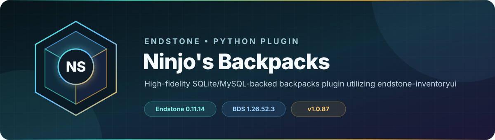

> Item-storage safety release **1.0.94**, Endstone **0.11.15 / BDS 1.26.60.6**. Install **InventoryUI 2.0.10** with this version. Full item NBT and auxiliary data are required; unreadable saved items block opening instead of being replaced with empty slots. Accepted ordinary backpack transactions checkpoint before acknowledgement. Failed primary saves remain in `backpacks.recovery.sqlite3` and pause moves until replay succeeds. Keep that journal with plugin data during backup/migration. Virtual-storage reconciliation checkpoints on the following tick.
>
> For cross-server backpacks, every server must use the **same Backpacks MySQL database**. Inventory Share alone carries the backpack item, not the separate Backpacks contents table. Do not point an existing installation at a new empty database as a recovery attempt. These changes do not reconstruct metadata or items already discarded by older saves.

<!-- endstone-professional-header:start -->

  

  
  

  
  
  
  =3.11" src="https://img.shields.io/badge/Python-%3E=3.11-3776AB?style=flat-square&amp;logo=python&amp;logoColor=white">

  <strong>High-fidelity SQLite/MySQL-backed backpacks plugin utilizing endstone-inventoryui.</strong>

  <a href="#what-it-does">What it does</a> &bull;
  <a href="#how-to-use">How to use</a> &bull;
  <a href="#commands-and-permissions">Commands</a> &bull;
  <a href="#install">Install</a> &bull;
  <a href="https://github.com/TheNINJALLO/endstone-ninjos-backpacks/releases">Releases</a>

## Overview

High-fidelity SQLite/MySQL-backed backpacks plugin utilizing endstone-inventoryui. This release is aligned with Endstone 0.11.15 and Minecraft Bedrock Dedicated Server 1.26.60.6, and is distributed as a Python wheel for direct installation in an Endstone server.

## What it does

- Provides persistent, tiered player backpacks backed by SQLite or MySQL.
- Preserves item data through high-fidelity serialization and InventoryUI menus.
- Adds linked advanced hoppers plus staff inventory and ender-chest management.

## How to use

1. Install `endstone-inventoryui`; install `blockdata-api` too when its integration is wanted.
2. Start once, review the generated backpack tiers, item mappings, and optional MySQL settings, then restart.
3. Hold the assigned backpack and use it (right-click air or a block). `/backpack` displays command help; staff assign tiers with `/backpack assign <player> <tier>`.
4. Use `/hopper link` while targeting the intended containers, and reserve `/manageinv` for staff.

## Commands and permissions

| Command / usage | What it does | Access |
|---|---|---|
| `/backpack` `/backpack assign [player: player] [tier: str] [extra_lore: message]` `/backpack config` `/backpack open [player_name: str] [tier: str]` `/backpack delete [player_name: str] [tier: str]` `/backpack info` `/backpack reload` `/backpack list` `/backpack cleanup` | Main command for NinjOSBackpacks | `ninjosbackpacks.command` |
| `/hopper` `/hopper info` `/hopper link` `/hopper unlink` `/hopper reload` `/hopper list` `/hopper debug [state: str]` | Control Advanced Hoppers | `ninjoshopper.use` |
| `/manageinv` | Open inventory management interface | `ninjosbackpacks.admin.inv` |

## Compatibility

| Component | Supported version |
|---|---|
| Endstone | `0.11.15` |
| Endstone API | `0.11` |
| Bedrock Dedicated Server | `1.26.60.6` |
| Python | `>=3.11` |
| Plugin release | `v1.0.94` |

## Install

Download both required wheels over HTTPS:

- [InventoryUI `v2.0.10`](https://github.com/TheNINJALLO/endstone-inventoryui/releases/download/v2.0.10/endstone_inventoryui-2.0.10-py3-none-any.whl)
- [Ninjo's Backpacks `v1.0.94`](https://github.com/TheNINJALLO/endstone-ninjos-backpacks/releases/download/v1.0.94/endstone_ninjos_backpacks-1.0.94-py3-none-any.whl)

Copy the downloaded wheel into the server's `plugins/` directory, remove any older wheel for the same plugin, and restart Endstone.

> [!IMPORTANT]
> Remove older InventoryUI and Backpacks wheels before installing these releases. Use Endstone `0.11.15` with BDS `1.26.60.6`, and back up worlds and plugin data before upgrading a production server.

## Configuration and secrets

Runtime databases, logs, local `.env` files, server directories, and root `config.toml` files are excluded from source releases. When an example configuration is provided, copy it locally and keep live tokens, passwords, webhook URLs, and server identifiers out of Git.

## Release automation

Every `v*` tag runs [the wheel release workflow](.github/workflows/wheel-release.yml), builds the package in a clean GitHub runner, stores the wheel as a workflow artifact, and attaches it to the matching GitHub release.
<!-- endstone-professional-header:end -->

## 1.0.93 startup compatibility

Requires InventoryUI **2.0.8**, which loads its protocol helpers privately and fixes the `NetworkStackLatencyPacket` import failure caused by shared protocol package conflicts. Backpacks no longer patches that shared package during import. Its existing NBT preservation integration and the 1.0.92 shulker-name fix are retained.

Stop the server, replace both wheels, keep one version of each plugin, and preserve all data. See [startup troubleshooting](https://github.com/TheNINJALLO/endstone-inventoryui/blob/main/docs/startup.md).

## 1.0.92 interaction repair

Bedrock stores the legacy `minecraft:shulker_box` backpack as `minecraft:white_shulker_box`. Backpacks now match both names, so existing gigantic backpacks open with existing configurations and keep their storage IDs. New configurations use the current item name. Other colors and custom item namespaces remain distinct.

Use InventoryUI **2.0.7** with this release. The installation link above now points to that version; the previous README linked to 2.0.6 even though the dependency required 2.0.7. See [validation](docs/validation.md) and [troubleshooting](docs/troubleshooting.md).

## 1.0.91 repair release

Install InventoryUI 2.0.7 alongside this release. Backpacks now require InventoryUI during plugin loading, wait for the menu-open acknowledgement before saving, block transactions during page changes, reject slots above the configured capacity, and release aborted sessions. Existing SQLite/MySQL storage and backpack IDs are preserved.

Stop the server before replacing the old wheel. Keep only one version of each plugin in `plugins/`; preserve plugin data folders. InventoryUI-dependent plugins need the InventoryUI wheel in `plugins/`, even when its Python package is already installed.
